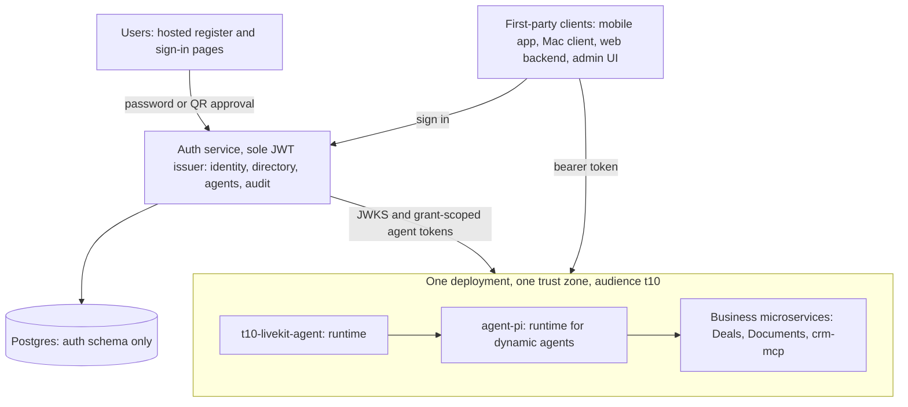
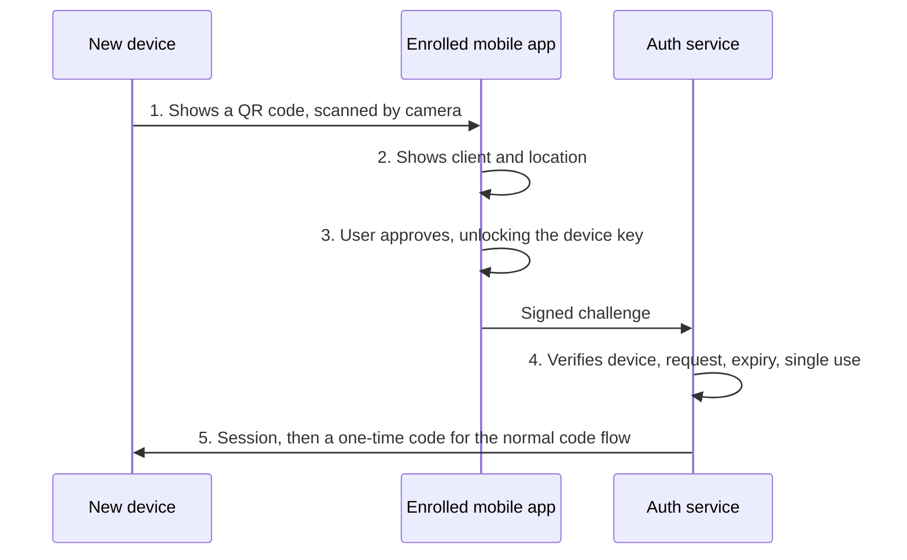
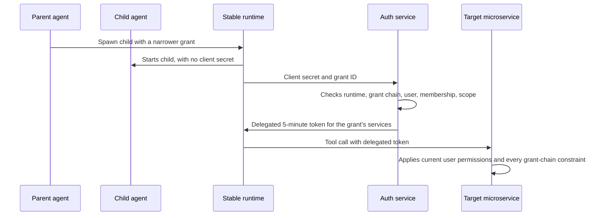

# Auth Server Design Doc

Oct 30, 2026 · @Felix Liang

## Summary

Build one small Go service that registers users, signs them in with its own credentials, holds sessions, tenants and agent grants, and is the only JWT issuer for t10. It depends on no outside identity provider and serves only the clients named in its config.

The init requirements are sound on boundaries: business modules own record-level access, and the shared service owns identity and organizational facts. They are oversized for first-party use, because they carry the machinery of a general identity platform. The design also has to fit what t10 already built: `t10-mac-client` calls `/v1/token` and `/v1/rooms/admission`, and `agent-pi` verifies JWTs against a JWKS URL.

Five decisions keep it small:

1. **Own one credential path.** Users self-register at once with a username, phone number or email plus a password, and can add TOTP MFA. Nothing is verified, and the service sends no email or SMS. There is no social login, SAML or enterprise SSO.
2. **Keep OAuth narrow.** Authorization code with PKCE stays, because the Mac client needs a real browser login. Clients are a static config list, with no consent screen, dynamic registration or client admin UI.
3. **Make the session the refresh credential.** One session row holds a rotating secret, or a device key on mobile, so there is no separate refresh-token store.
4. **Collapse agent access into one table.** One grant row per execution replaces separate execution and delegation models.
5. **Run one container and Postgres.** There is no Redis, message broker or OpenFGA in v1.

Two existing behaviors must change to get there: the Mac client's password login, and the single `AGENT_PI_TOKEN` shared by all LiveKit callers.

All microservices run in one deployment, so they pass the user's token through unchanged. Dynamic agents never receive that token: each spawn is one narrower grant under a stable runtime, exchanged for a token that names both the user and the agent, so runs can continue for hours while the user is offline.

A mobile app acts as the user's authenticator: scanning a QR code with it signs in another device without a password.

Owning credentials is where this design carries the most risk. With no verified contact, recovery depends on recovery codes and admins, and registration is cheap to abuse. A security review is a release gate for sign-in.

## Requirements review

Most of the init requirements stand; the cuts come from dropping general-platform features, not from weakening any security rule. "First-party" is read here as: t10 builds every OAuth client, and users sign in only with t10 credentials.

| Requirement area | Verdict | Change for this design |
| --- | --- | --- |
| Modular monolith, one deployment | Keep | Also applies inside the service: four code packages, not five modules |
| Separate module-owned schemas | Simplify | One `auth` schema, so foreign keys can enforce tenant integrity. Ownership stays by code package |
| Credentials, MFA and SSO | Simplify | Username, phone or email with a password and TOTP, owned by this service. Self-registration is added, with no verification. SSO and `issuer + subject` links are removed, because no external issuers exist |
| OAuth/OIDC clients | Simplify | Static config, not a database table or admin screen |
| Code flow with PKCE | Keep | Used by the Mac client and any web backend. The mobile app uses a direct login API instead |
| Access and refresh tokens | Simplify | 5-minute access JWT with one platform audience, not one per service. The session row is the refresh credential |
| Service authentication | Simplify | One mechanism: client ID and secret, with two active secrets for rotation |
| Departments and org units | Simplify | One `org_units` tree. A department is a unit |
| Manager relationships | Keep | One manager per membership. Matrix reporting is out of v1 |
| Platform Administration module | Merge | Becomes a role table plus tenant lifecycle endpoints |
| Business-module administrators | Move | Owned by each business module, alongside its policies |
| Support access | Defer | V1 has no support feature, but platform admins can step into a tenant to rescue it. See "Platform access to a tenant" under Security considerations |
| Dynamic agent grants | Simplify | One `agent_grants` table. The grant ID is the execution ID |
| Change events | Defer | Modules cache org reads for at most 60 seconds. Add an outbox when a module needs a local copy |
| Admin UI | Moved out | This service serves the JSON routes, and checks every call. Tenant admins work in `workbench`, platform admins in `t10-console`, so each kind of admin has one place |
| OpenFGA | Remove | Not needed by any stated rule |

### Gaps the requirements do not cover

These came from reading the requirements against the sibling repos. Each is resolved later in this doc.

- **Password login conflicts with the code flow.** `t10-mac-client` sends `grant_type: password` to `/v1/token`. A native client cannot keep that and also meet the PKCE requirement.
- **Forwarded tokens break audience rules.** MCP servers configured with `auth: "forward"` receive the caller's bearer token. A token for `agent-pi` then reaches `crm-mcp`, which could replay it against `agent-pi`.
- **Short tokens break long runs.** `agent-pi` drops a principal once its token expires, and tools then ask the user to reconnect. A 5-minute token fails on any longer tool run.
- **One token hides every LiveKit caller.** `t10-livekit-agent` uses one `AGENT_PI_TOKEN` for all identities, so per-user limits and permissions cannot apply. Its own design doc names per-user JWTs as the fix.
- **Opaque constraints cannot be compared.** The identity module cannot prove a child grant narrows its parent's business constraints, because it must not parse them.
- **Filtering needs org data at query time.** Deals must filter before pagination, so it needs a manager's report list in hand before it builds the query.
- **Registration is not specified.** The requirements list credentials but no signup, sign-in name or recovery rules, and they do not say how a new user gets a first tenant.

## Goals and non-goals

The goal is an auth service one engineer can run, with a small enough surface to review in full.

**Goals**

- Let users register immediately with a username, phone number or email, and sign in with no outside identity provider.
- Give every t10 client, microservice and agent one issuer, one JWKS and one token format.
- Carry the user's identity across microservice calls, with no auth call on any hop.
- Let the mobile app approve sign-ins on other devices.
- Let agents spawn dynamically without registering anything per agent.
- Keep `/v1/token` and `/v1/rooms/admission` compatible with the existing Mac client, apart from the password grant.
- Give LiveKit calls and `agent-pi` runs a per-user identity.
- Provide authoritative tenants, memberships and org facts to business modules.
- Bound every agent execution by user, tenant, actions and expiry.
- Audit every identity, membership, role and grant change.

**Non-goals**

- Third-party OAuth clients, consent screens, dynamic client registration and a public OIDC provider.
- Social login, SAML and enterprise SSO.
- Record-level authorization, which stays in business modules.
- A service mesh or mTLS rollout. Token checks do not depend on one.

## Proposed architecture

The service is the system of record for accounts: it verifies credentials itself and issues its own JWTs. Downstream services verify those JWTs offline with the JWKS, so they never need a shared secret or a per-request call to the auth service.

Clients get tokens from the auth service, services pass user tokens through, and only runtimes exchange grants for agent tokens.

### Modules

The service has four Go packages that call each other only through exported interfaces.

| Package | Owns |
| --- | --- |
| `identity` | Users, credentials, MFA, sessions, service accounts, token issuance |
| `directory` | Tenants, memberships, org units, managers, invitations, platform admins |
| `agents` | Agent grants, delegation checks, room admission |
| `audit` | Append-only audit log |

### Clients

Clients are static config entries with exact-match redirect URIs and a fixed audience list.

| Client | Type | How it authenticates |
| --- | --- | --- |
| Mobile app | Public, native, authenticator | Native login screen and `/v1/login`, then a device key |
| `t10-mac-client` | Public, native | Code flow with PKCE, through the system browser and a loopback redirect |
| Future web backend | Confidential | Code flow with PKCE, tokens held server-side |
| Admin UI | Same process | Cookie session, no OAuth round trip |
| `t10-livekit-agent` | Service account | Client credentials, then grant exchange |
| `agent-pi` | Service account and token verifier | Client credentials, then grant exchange |

### Registration and sign-in

Registration and sign-in run on server-rendered pages at the auth service, so the Mac client and web backends never handle a password. The mobile app is the one exception, with its own native screens.

**Registration**

1. The user submits a sign-in name and password at `/v1/register`, directly or from an invitation link.
2. The service normalizes the name, rejects it if taken, stores an Argon2id hash and creates an active user. There is no verification step.
3. The service shows ten single-use recovery codes, once.
4. A user with an invitation link joins that tenant. The link is single-use and expires after 7 days.
5. Any other new user gets a new tenant and becomes its admin, so every active user has at least one membership. This applies in dev mode only, because deployed registration needs an invitation.

**Sign-in names**

One sign-in box accepts all three kinds, and their formats cannot overlap. A user can hold several, all pointing to the same account.

| Kind | Accepted format | Stored as |
| --- | --- | --- |
| Username | 3 to 32 letters, digits, `.`, `_` or `-`, starting with a letter | Lowercase |
| Phone number | Starts with `+` or a digit, and parses as a valid number | E.164, using a configured default region |
| Email | Contains `@` | Lowercase |

Because nothing is verified, a sign-in name proves nothing about who owns it. It is never used for recovery, invitation matching or contacting the user. Someone can claim another person's phone number or email, so a platform admin can release a disputed name, with an audit record.

**Sign-in**

1. The client opens `/v1/authorize` with a PKCE challenge and a redirect URI.
2. If the browser already has an auth cookie, the flow skips to step 4. Otherwise the user enters a sign-in name and password, plus a TOTP code if enrolled.
3. The service creates the session and sets the cookie.
4. The service redirects with a 60-second, single-use code.
5. The client redeems the code at `/v1/token` and receives an access token plus a session secret. The Mac client stores the secret in the Keychain.

**Recovery**

With no verified contact, there is no "forgot password" link. A recovery code allows one password reset, and an account with MFA also needs its TOTP code or a second recovery code. Every reset revokes the user's sessions and agent grants.

A user with no codes needs an admin. A tenant admin can issue a member a single-use reset link valid for 30 minutes, and a platform admin can do the same for any member. Both are audited. A sole user who loses their password and codes depends on a manual identity check, which may fail.

Tokens and module data key on the stable user ID, never on a sign-in name, so a user can add or change names freely. This keeps the intent of the requirement to identify users by issuer and subject.

### Mobile app

The mobile app is both a first-party client and the user's authenticator. It has its own native register and login screens, then approves sign-ins on other devices without a password.

**Enrolling a device**

1. The app creates two key pairs in the Secure Enclave or Android Keystore: an approval key unlocked only by biometrics or the device passcode, and a session key it can use silently.
2. The user enters a sign-in name and password on the app's own screen. The app sends them to `POST /v1/login` with both public keys and a signature from the session key.
3. If MFA is enrolled, the service returns a 5-minute challenge, and the app completes it at `POST /v1/login/mfa`.
4. The service creates a device-bound session and returns an access token. No browser or redirect is involved, so this path needs no PKCE.

The private keys never leave the device. In-app registration and recovery work the same way, through JSON endpoints that share the web pages' rules and limits.

A second device must be approved from the first, or enroll with a password and any MFA.

**Approving a sign-in**

The sign-in page shows a QR code next to the password form. The Mac client already opens that page in a browser, so it needs no change. A QR request is single-use, expires after 2 minutes and is rate limited.

The QR code moves no secret by itself; only the device's signature, made after local unlock, approves the request.

**Decisions and limits**

A native login screen is acceptable here only because t10 builds the app. No other client may use `/v1/login`. A client ID does not enforce that, though, because a script can call the API too.

- **Strength:** an approval combines the device key with biometrics or the passcode, so it counts as two factors and needs no password.
- **Second factor:** an enrolled app can also replace TOTP after a password sign-in.
- **QR phishing:** an attacker can show their own code on a fake site. The app therefore shows the requesting client and approximate location, and asks the user to confirm before signing.
- **No push in v1:** push adds APNs and FCM dependencies, and FCM is unavailable on many Android phones in China. It also invites approval-spam attacks, so if it is added later it needs number matching.
- **Lost phone:** signing in elsewhere with a password or recovery code lets the user revoke the device. That also ends its sessions and approval rights.
- **Recovery:** an enrolled app can reset the password after a biometric check. This reduces, but does not remove, the lockout risk.

### Sessions and tenant selection

The session row is the refresh credential. On the Mac client, `grant_type=refresh_token` rotates its secret and returns a new access token. The previous secret stays valid until the new one is first used, so a lost response cannot sign the user out. Using the previous secret after that revokes the session.

The existing `tenant` field on `/v1/token` selects the active tenant. The service checks an active membership before accepting it and stores the result on the session. The `tenant` field on room admission must match the token's `tid`.

**Staying signed in**

The mobile app stays signed in for as long as the user keeps using it. Each refresh extends the idle limit, and there is no absolute limit. Lifetimes are set per client in config.

| Client | Idle limit | Absolute limit |
| --- | --- | --- |
| Mobile app | 90 days | None |
| Mac client | 30 days | 90 days |
| Browser and admin UI | 12 hours | 7 days |

The app refreshes only while in use, so background activity cannot keep an abandoned session alive. Every refresh rechecks the user, device and membership, so a long session never outlives a revocation.

A mobile refresh is signed with a hardware-backed session key instead of using a rotating secret. A stolen copy of the app's storage is then useless, and flaky mobile networks cannot cause a rotation failure that signs the user out. The session key works silently, so a refresh never prompts for biometrics.

A long session means an unlocked phone is enough to use the app. Changing a password, adding a device or changing MFA therefore needs a fresh biometric check, and users can turn on an app lock.

### Tokens

Access tokens are ES256 JWTs that live for 5 minutes. They match what `agent-pi` already accepts, so production config is only `AUTH_KIND=jwt` with the issuer, JWKS URL, `JWT_AUDIENCE=t10,agent-pi`, `JWT_REQUIRED_SCOPES=agent:use` and `JWT_TENANT_CLAIM=tid`.

| Claim | Meaning |
| --- | --- |
| `iss`, `aud`, `exp`, `iat`, `jti` | Standard fields. `aud` names t10 on user tokens, and the grant's listed services on agent tokens |
| `sub` | Stable user ID, or service account ID for a service token |
| `tid` | Active tenant, validated against membership at mint time |
| `scope` | Coarse entry rights such as `agent:use`, never record permissions |
| `sid` | Session ID, on user tokens only |
| `act.sub` | Runtime acting for the user, on agent tokens only |
| `grant` | Agent grant ID, on agent tokens only |
| `trg` | Why the run is running: `user`, `voice`, `schedule`, `event` or `webhook`, on agent tokens only. `agent` is reserved for delegation |
| `automation` | The automation that started the run, on agent tokens whose trigger is `schedule`, `event` or `webhook` |

### Microservice calls

All services run in one Compose or Kubernetes deployment, which is treated as one trust zone. A user token carries `aud=t10`, and each service passes it to the next one unchanged. This adds no auth call on any hop and no token cache.

Pass-through depends on four rules:

- **One way in.** Only the ingress is public. Internal services sit on a private network, enforced by Compose networks or Kubernetes NetworkPolicy.
- **Every service verifies.** Each one checks the signature, `iss`, `aud` and `exp` itself. It accepts an audience of t10, used by user tokens, or its own name, used by delegated tokens. No service trusts a user or tenant ID from a header.
- **Tokens stay inside.** A token is never logged, stored or sent to anything outside the deployment.
- **Agents do not get user tokens.** Dynamic agents and their tools use grant-scoped tokens limited to the grant's listed services, as described below.

The cost is blast radius. A compromised service can act as any user whose token it sees, for up to 5 minutes, at every other service. Internal calls also lose the `act` record of which service called which, so traces carry that instead.

The agent boundary stays strict because agents run model-driven code that can be prompt-injected. A user's token stops at `agent-pi`, which then works from a grant. Per-hop exchange can be added later without changing the token format, if a service moves outside the deployment or another team runs it.

Service calls with no user, such as a scheduled job, use a `client_credentials` token with `aud=t10` and no `tid`, unless the call names a tenant in config.

### Agent grants

A grant is one row per execution, and its ID is the execution ID. It binds a runtime, user, tenant, allowed actions, allowed services, opaque constraints and an expiry.

Dynamic agents need no registration. Only the stable runtime that hosts them has credentials. Spawning an agent means the runtime writes one child grant row, and that agent never holds a client secret. A spawned agent gets tokens only through its runtime, so a prompt-injected agent cannot name a different user, tenant or grant.

Effective access is the user's current permissions, intersected with the grant chain and tenant policy. The auth service checks the chain's validity; the target service applies its meaning.

- **Creation:** room admission creates one for a call. `agent-pi` creates one for a run by presenting its own credentials and the user's token. Model output never supplies these values.
- **Exchange:** the runtime authenticates itself and presents a grant ID at `/v1/token`. The service checks the runtime, the full ancestor chain, user status, membership and scope before it mints a token.
- **Children:** a child's actions must be a subset of its parent's, and its expiry cannot be later. Depth is capped at 4.
- **Opaque constraints:** `GET /v1/grants/{id}/chain` returns every ancestor's constraints. The owning module must pass all of them, so narrowing never has to be proved centrally.
- **Permission changes:** actions are an explicit list with no wildcards. New action types never flow into an existing grant. Record access follows the user's current permissions, in both directions, because modules evaluate them at request time.
- **Sign-out:** a grant is bound to the user, not the session, so a call or run survives a device sign-out. "Sign out everywhere", a password reset, membership removal and user suspension all stop it.

A grant ID is safe to persist, unlike a token. `agent-pi` can store it, so a run resumed after a restart can exchange it for a fresh token instead of asking the user to reconnect.

### Tool calls and long runs

A tool call carries one delegated token that identifies both the user and the agent, so tools never need two tokens. The token comes from the grant rather than the user, which lets a run continue for hours while the user is offline.

| What a tool needs | Where it comes from |
| --- | --- |
| User | `sub` |
| Tenant | `tid` |
| Runtime | `act.sub` |
| Agent execution | `grant` |
| Allowed services | `aud`, which lists the services named on the grant |
| Allowed access | Current user permissions, intersected with `scope` and the grant chain |

Code that reads `sub` and `tid` keeps working, because a delegated token has the same claims as a user token plus the agent's. A tool can also pass the token to another service on the grant, using the same pass-through rule as other services.

**MCP servers**

An MCP server receives the delegated JWT in the `Authorization` header, where `auth: "forward"` sends the user's original JWT today. The original never reaches it, even while the user is online, so every MCP call works the same way during live and unattended runs.

1. The server verifies the JWT against the JWKS, like any other service.
2. It reads the user and tenant from `sub` and `tid`, and applies that user's current permissions.
3. It also sees `act.sub` and `grant`, so it must enforce `scope` and the grant chain as well.
4. To call another service, it passes the same JWT along, if that service is listed in `aud`.

Step 3 is the rule that matters: a service that reads only `sub` would give an agent the user's full rights. A shared verifier library, for Go and TypeScript, makes this check the default. It returns the user and any agent context together, and it rejects a delegated token if the grant chain cannot be fetched.

**How a run gets tokens**

1. The user's request reaches `agent-pi` with an `aud=t10` token. `agent-pi` verifies it, creates a grant and stores the grant ID with the session. The user's token goes no further.
2. Before a tool call, `agent-pi` uses its cached delegated token, or mints a new one if less than 60 seconds remain.
3. Every mint rechecks the grant chain, user status and membership, so a removed user's agents stop within 5 minutes.
4. After a restart, `agent-pi` reads the stored grant ID and mints a new token, so the user does not need to reconnect.

A grant lasts 8 hours by default. Each new user request extends it, up to 24 hours from creation. A LiveKit call follows the same path: `agent-pi` receives a delegated token and creates a child grant from it.

**What happens during a run**

| Event | Result |
| --- | --- |
| User goes offline | The run continues under the grant |
| Grant reaches its expiry | The run pauses and asks the user to renew |
| Grant revoked, user suspended or membership removed | The next mint fails, and the run stops |
| Auth service unavailable | The run retries with backoff, then resumes |
| A tool outlasts its token | The tool renews with its own service account and the grant ID |

A service can renew only if it is listed on that grant. Delete and export actions stay out of default grants, so an unattended run cannot perform them. Adding them needs a new grant created with a live user token.

`agent-pi` must not store the user's session secret to achieve the same result, because that would give the agent all of the user's rights, for as long as the session lasts.

**Changes needed in `agent-pi`**

- Store the grant ID in the session document, and make `CredentialStore` return tokens minted from it.
- Replace `auth: "forward"` with a grant-backed mode. Its "ask the user to reconnect" errors then go away.
- Stop closing an MCP connection while calls are running on it. `McpManager` closes the old client when the token changes, so 5-minute rotation could break a call in progress.
- Give `consult_expert` a child grant. It currently inherits the parent's credentials, which breaks the rule that each spawned agent has its own bounded grant.

### Organizational data

Modules read org facts through `/v1/org` endpoints, using a service token. `GET /v1/org/members/{id}/reports?transitive=true` returns the user IDs that Deals needs for a `WHERE owner_id = ANY(...)` filter before pagination. Modules may cache these reads for up to 60 seconds and must fail closed when both the cache and the service are unavailable.

Managers are a nullable self-reference on `memberships`, and org units are a parent-child tree. Composite foreign keys that include `tenant_id` make cross-tenant links impossible. Cycle checks use a recursive query under a per-tenant advisory lock, so two concurrent edits cannot create a cycle together.

### Data model

| Table | Key columns | Notes |
| --- | --- | --- |
| `users` | `id`, `status`, `display_name` | Status is `active` or `suspended` |
| `user_identifiers` | `kind`, `value`, `user_id` | Primary key is `kind + value`. Holds usernames, phone numbers and emails |
| `credentials` | `user_id`, `password_hash`, `password_changed_at`, `failed_count`, `locked_until` | Argon2id hash with its parameters |
| `mfa_factors` | `id`, `user_id`, `kind`, `secret_encrypted`, `last_used_step`, `verified_at` | TOTP in v1. `last_used_step` blocks code replay |
| `devices` | `id`, `user_id`, `name`, `platform`, `approval_public_key`, `session_public_key`, `last_used_at`, `revoked_at` | One row per enrolled mobile app |
| `qr_logins` | `id_hash`, `client_id`, `requester_ip`, `status`, `user_id`, `device_id`, `expires_at` | Single use, 2 minutes |
| `recovery_codes` | `user_id`, `code_hash`, `used_at` | Single use, issued at registration |
| `reset_tokens` | `token_hash`, `user_id`, `issued_by`, `expires_at`, `used_at` | Admin-issued, single use, 30 minutes |
| `rate_limits` | `key`, `window_start`, `count` | Postgres counters per IP and account |
| `sessions` | `id`, `user_id`, `client_id`, `device_id`, `active_tenant_id`, `secret_hash`, `prev_secret_hash`, `idle_expires_at`, `absolute_expires_at`, `revoked_at` | Secrets stored as SHA-256 hashes. Mobile sessions use `device_id` instead, with no absolute expiry |
| `auth_codes` | `code_hash`, `session_id`, `client_id`, `code_challenge`, `redirect_uri`, `expires_at`, `used_at` | Single use, 60 seconds |
| `tenants` | `id`, `name`, `status` | Suspending a tenant blocks minting |
| `memberships` | `id`, `tenant_id`, `user_id`, `role`, `status`, `manager_id`, `org_unit_id` | Role is `member` or `admin` |
| `org_units` | `id`, `tenant_id`, `parent_id`, `name`, `kind` | `kind` includes department |
| `invitations` | `tenant_id`, `role`, `token_hash`, `expires_at`, `accepted_at` | Link-based, single use, 7 days |
| `platform_admins` | `user_id`, `granted_by`, `granted_at` | Grants no tenant membership |
| `service_accounts` | `id`, `name`, `secret_hash`, `next_secret_hash`, `status` | Two hashes allow rotation without downtime |
| `agent_grants` | `id`, `parent_id`, `runtime_id`, `user_id`, `tenant_id`, `actions`, `audiences`, `constraints`, `created_at`, `expires_at`, `revoked_at` | `constraints` is opaque JSON |
| `audit_log` | `id`, `at`, `actor`, `scope`, `action`, `target`, `outcome`, `detail` | Append-only |

## Deployment and operations

The service ships as one static Go binary in one container, backed by one Postgres database. Go matches `t10-livekit-agent` and `t10-mac-client`, and Docker Compose matches how the sibling repos run today.

| Concern | Decision |
| --- | --- |
| Runtime | Two stateless replicas on Kubernetes behind TLS at the ingress, and one on `:8081` under Docker Compose for local use. See [deployment.md](deployment.md) |
| Database | Managed Postgres with backups and failover, separate from business data |
| Migrations | Embedded in the binary, run at startup under a Postgres advisory lock |
| Admin UI | None. Tenant admins use `workbench` and platform admins `t10-console`, both through the JSON routes |
| Signing keys | Two ES256 private keys from the secret store: current and next |
| Configuration | Environment variables plus one reviewed YAML file for clients and the audiences each runtime may request |
| Telemetry | OpenTelemetry export to the collector the sibling repos already use |
| Bootstrap | `authctl` command creates the first platform admin and tenant |

**Key rotation:** publish the next key in the JWKS, wait longer than the longest verifier cache, then switch signing to it and retire the old key. `agent-pi` refetches its JWKS on an unknown `kid`, which keeps this safe.

**Local development:** `AUTH_DEV_MODE=true` keeps the password grant working for seeded users, so the Mac client's `-username` flow still runs against Compose. The service refuses to start in this mode unless its public URL is localhost.

**No messaging dependency:** the service sends no email or SMS, so there is no provider to run or pay for, and sign-in has one less way to fail.

**Password hashing:** Argon2id uses a lot of CPU and memory on purpose. Each replica caps concurrent hashes, so a login flood cannot starve token exchange. The TOTP encryption key lives in the secret store beside the signing keys.

**Availability:** verification is offline, so services keep accepting valid tokens during an auth outage, for up to 5 minutes. After that, sign-in, refresh and exchange all fail closed, so auth availability becomes product availability. That is why it runs two replicas and a failover database from day one.

## Security considerations

Credential handling is now the largest risk in the service, so an external security review is required before public registration opens. The main design trade-off is revocation: offline verification means a revoked token keeps working until it expires, for at most 5 minutes. High-risk actions can close that window by checking status with the auth service.

| Change | Takes effect |
| --- | --- |
| Session revoked | Refresh stops at once. Access tokens last up to 5 minutes |
| Membership removed or tenant suspended | Minting stops at once. Existing tokens last up to 5 minutes |
| Grant revoked | Exchange stops at once, including all descendants. Existing tokens last up to 5 minutes |
| Manager or org change | Up to 60 seconds through module caches |
| Business policy change | At once, because modules evaluate it per request |
| Service account disabled | Exchange stops at once. Existing tokens last up to 5 minutes |

- **Passwords:** Argon2id with a tuned cost, a 10-character minimum and a blocklist of common and known-breached passwords. Hashes upgrade at next sign-in when parameters change.
- **Brute force:** per-account and per-IP limits apply to sign-in, registration, recovery and TOTP, on both web pages and the mobile API. Accounts lock for a short, growing period rather than permanently, which limits lockout attacks.
- **Account enumeration:** sign-in returns the same response for unknown names and wrong passwords, and unknown names still run a dummy hash so timing does not leak. Registration must reveal that a name is taken, so it relies on rate limits.
- **Registration abuse:** with no verification, an account costs an attacker nothing and comes with its own tenant. Per-IP limits and a CAPTCHA apply from day one, and the mobile API needs the same check, or scripts will simply skip the web page.
- **Agent cost:** new tenants get a low quota on agent runs and model spend, because each fake account could otherwise run agents at t10's expense.
- **Name squatting:** unverified phone numbers and emails can belong to someone else. The UI labels them as unverified, and no feature treats them as proof of identity.
- **MFA:** TOTP or app approval is optional for members, and tenant admins can require it for their tenant. It is mandatory for platform admins.
- **Credential changes:** changing a password or sign-in name needs the current password and MFA, or a fresh biometric check in the mobile app. A password change revokes other sessions.
- **Token storage:** session secrets, codes, reset tokens, invitations and service secrets are stored only as hashes. Grant IDs alone are useless without the runtime's credentials.
- **Tenant isolation:** `tid` comes from the session or grant, never from a client value that has not been checked. Room names are namespaced by tenant at admission.
- **Room credentials:** the LiveKit API secret lives only in the auth service. The grant ID travels as a participant attribute in the LiveKit-signed token, so a client cannot alter it.
- **Browser requests:** auth pages and the admin UI use a `__Host-` cookie with `SameSite=Lax`, an Origin check on writes and a re-sign-in within 15 minutes for platform actions.
- **Endpoint enforcement:** every handler declares its required role in the route table, and a test fails if a route has none.
- **Audit:** changes write audit rows in the same transaction. Denied actions write separately, because their transaction rolled back. The app's database role has no `UPDATE` or `DELETE` on `audit_log`. Proposed: rows carry the platform's shared audit fields from [`contracts/audit/README.md`](../../contracts/audit/README.md), adding `act`, `grant`, `trigger`, `automation` and `turn_id` where a run or request supplies them, so the console and `workbench` can show these rows beside other services' records. These are audit records, not logs, and are never written by logging.
- **Platform access to a tenant:** this is deliberate break-glass, for rescues such as a tenant whose only admin is suspended. A platform admin with a second factor from the last 15 minutes passes every tenant-admin route, whichever tenant their token names, can issue a reset link for any member, and can add any user to a tenant, themselves included, then reach its business records as a member. Nothing stops this, so the control is that the tenant can see it: each write adds a `platform_access.write` row to the tenant's own audit log, reads add at most one `platform_access.read` per admin an hour, and a failed write refuses the request. Someone with both roles working in their own tenant is an ordinary tenant admin and adds no row. A guided support feature, such as time-limited access a tenant approves, would need its own design.

## Alternatives, open questions and rollout

The recommendation is to build credentials into the service, using vetted libraries for Argon2id, TOTP and JWT rather than custom crypto. Self-hosted identity servers are the closest alternative. Notes below are general knowledge, not checked against their current features.

### Alternatives considered

| Option | Why not |
| --- | --- |
| Self-host Keycloak or Zitadel | Includes registration and MFA, but adds a second stateful system to run and upgrade. Tenants, org facts and agent grants still need custom code around it |
| Self-host a headless credential service such as Ory Kratos | Removes the most credential code, and is the best fallback if the security review goes badly. It still adds a second service to deploy |
| Check every token with the auth service | Makes revocation instant, but every microservice request then depends on auth |
| Exchange tokens on every service hop | Limits a leaked token to one service, but adds an auth dependency, a token cache and a call allow-list inside one trust zone. It remains the upgrade path |
| Shared session cookie at an edge proxy | Does not fit the Mac client or service-to-service calls |

### Open questions

- [ ] **Is recovery without a verified contact acceptable?** Users who lose their password and recovery codes may lose the account. An enrolled mobile app lowers this risk, but users without one remain exposed. Optional verification could be added later without changing sign-in.
- [x] **Should anyone be able to register?** Not for now. Deployed registration needs an invitation, and "What is the plan for public sign-up?" covers opening it later.
- [ ] **What are the new-tenant quotas?** They need numbers before public registration opens.
- [ ] **Which CAPTCHA works for the audience?** The repos point to China-based use (`Asia/Shanghai`, DashScope), and some services may not work there.
- [ ] **Will outside MCP clients connect?** External tools count as third-party OAuth clients and would need the consent and registration work this design removes.
- [ ] **Which microservices exist?** Pass-through assumes all of them run inside the deployment. Confirm the full inventory, including Deals, Documents and the `agent-pi` sales app.
- [ ] **Where does it run?** Docker Compose locally and Kubernetes in production. The cloud and cluster are still open. A cloud with workload identity could replace service account secrets later.
- [ ] **How long is audit data kept?** This depends on customer contracts. `contracts/audit/README.md` proposes one per-tenant retention setting for every service's records.
- [ ] **Are the proposed limits right?** The session lifetimes, 5-minute token, 8-hour default grant, 24-hour cap, depth 4 and 60-second cache are starting values.
- [ ] **Who does the external review?** A firm needs choosing and briefing with [security-review.md](security-review.md). Production infrastructure can't be assessed until "Where does it run?" is answered.
- [ ] **What is the plan for public sign-up?** Registration stays invite-only until the CAPTCHA, new-tenant quotas and a real breached-password list exist. The hand-written blocklist has about 60 entries. Deciding the CAPTCHA before the review lets reviewers see it.
- [ ] **Should the audit log get its own migration role?** The app's database role owns `audit_log` and runs migrations, so it could drop the triggers that block changes. A separate role fixes this and adds a credential to manage. The recommendation is to add it.
- [ ] **Should org reads be limited per service?** Any active service account can read any tenant's org data by naming the tenant. That fits one trust zone, but a per-service allow-list would shrink what one compromised service can see.
- [ ] **What happens when someone loses their authenticator?** With fewer than two recovery codes, they are locked out for good. The recommendation is an audited platform-admin "remove second factor" action.

### Rollout

1. **Core service.** Ship JWKS, tenants, memberships, room admission and the dev password grant, so the Mac client runs unchanged locally.
2. **Accounts and sign-in.** Add registration, sign-in names, recovery codes, TOTP and the code flow, move the Mac client to loopback PKCE, and turn off the password grant outside dev.
3. **Mobile app.** Add the login API, device enrollment, QR approval and app-based reset.
4. **Security review.** Complete the external review before public registration opens.
5. **Per-user voice.** Create a grant at admission, have `t10-livekit-agent` exchange it, and retire `AGENT_PI_TOKEN`. Built.
6. **Microservices.** Add the shared verifier to every service, accept each service's own name as well as `aud=t10`, and close all public access except the ingress. The verifier is built for Go and TypeScript. Adopting it waits on "Which microservices exist?", and closing access waits on a production cluster. For the auth service, the network policy in [deployment.md](deployment.md) is built.
7. **Agent runs.** Make `agent-pi` a runtime that stores grant IDs, mints tokens on demand and spawns child grants, then remove `auth: "forward"`. Built.
8. **Directory and admin.** Add org units, managers, `/v1/org` reads and the admin UI. Built, including user suspension and platform role changes.
