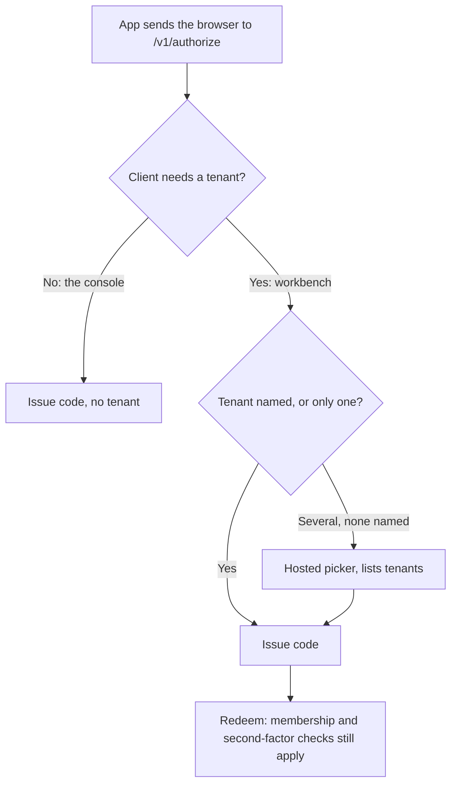

# Sign-in, landing and moving between apps

Nov 6, 2026 · Status: the front door, tenant picker and switcher (sections 1 to 3), and the sign-out wording in section 5, built and deployed locally, uncommitted. Deep links and `max_auth_age` are proposed. Decided Nov 6: Sign out ends only the app you're in, and the console asks for a password again after an hour away. Spans `auth-server`, `workbench` and `t10-console`. It keeps the two addresses in "Admin surfaces" in [`ARCHITECTURE.md`](../../ARCHITECTURE.md).

## Summary

Signing in once already works. Someone signed in to `workbench` opens the console with no password. What's missing is everything around that: where you land, how you choose, how you move across, and how you leave.

Six changes close this:

1. **One front door.** `auth-server` sends each person to the right place after sign-in, instead of to account settings. What they see when they arrive is in [the first screen](../../workbench/docs/first-screen.md).
2. **A tenant picker that lists tenants.** Nobody types a tenant ID, and the console stops asking for a tenant it doesn't use.
3. **One switcher.** Both apps show the same list of places, from one `auth-server` read.
4. **Links that keep your place.** The console's page for a tenant and that tenant's Administration link to each other.
5. **Sign-out says what it did.** It ends only the app you're in, and both apps now tell you that the browser is still signed in.
6. **The console asks again after an hour away.** Its idle limit becomes a real password prompt.

The console stays a separate app off the public ingress, and each app keeps its own cookie. This adds no new way into a tenant. A platform admin's existing break-glass access stays, and the tenant's audit log records it, as "Platform access to a tenant" in [`design.md`](design.md#security-considerations) describes.

## What happens today

Signed in on the local cluster on Nov 6, in dev mode, in a fresh browser for each cell.

| Who | `auth-server` `/v1/signin` | `auth-server` `/admin` | `workbench` | `t10-console` |
| --- | --- | --- | --- | --- |
| Member of one tenant, `sample-member` | Account settings, **no link to `workbench`** | **"You don't administer anything here", no links** | Home | "No access", with Open workbench |
| Member of several, `sample-multi` | Account settings, **no links** | **"You don't administer anything here", no links** | **Type a tenant ID** | **Type a tenant ID** |
| Platform admin only, `sample-platform` | Account settings, link to the console | Console | **"Ask a tenant admin for an invitation link"**, with a console button | Fleet |
| Both roles, `ada@acme.example` | Account settings, links to both | A page with both links | Home | Fleet |

Moving and leaving, as `ada@acme.example`:

| Action | Result |
| --- | --- |
| Signed in to `workbench`, open the console | No password. This part works |
| Sign out of `workbench`, then Sign in | Back in with no password. The page says so, and links to the account page |
| Sign out of `workbench`, reload the console | Console still signed in |
| Sign out of the console, then reopen it | **Back in with no password.** The page says only "You've signed out of this console" |

The problems behind those results:

- **Account settings is the default landing.** `defaultNext` is `/v1/account`, and `/` on `auth-server` answers 404. A person who accepts an invitation also lands on account settings, from `handleJoin`.
- **The console doesn't say what sign-out covered.** Each app has its own session, and ending one leaves the rest and the browser's own running. That stays, as section 5 explains, but the console's page should say so as `workbench`'s does.
- **The console's idle limit doesn't re-prompt.** `/v1/authorize` checks only the browser session, which lasts 12 hours idle and up to 7 days, so an expired console session comes back with no password. I read this in the code and didn't wait out the limit.
- **Tenant choice happens too late.** The app learns a tenant is needed only when redeeming the code, and it holds no token yet, so it can't list them. `auth-server` could list them at sign-in. The console's page even says the choice doesn't change what you can do there.
- **A tenant's policy can block the console.** The console passes through the same tenant check, so a tenant requiring a second factor can refuse a console sign-in with "That tenant needs a second factor". This comes from reading the code. I didn't reproduce it.
- **Places are configured three times.** `auth-server` has `AUTH_CONSOLE_URL` and `AUTH_WORKBENCH_URL`, `workbench` has `WORKBENCH_CONSOLE_URL`, and the console has `WORKBENCH_PUBLIC_URL`.
- **Links are inconsistent and generic.** `workbench` opens the console in a new tab, while the console opens `workbench` in the same tab. Both go to the root, though `/tenants/{id}` and `/t/{id}/admin` exist. The same place is called "Administration" and "Organization settings".

## Design

### 1. One front door

`GET /` on `auth-server` becomes the front door, replacing `/v1/account` as the default after sign-in. It works from the destinations in section 3:

| Destinations | Result |
| --- | --- |
| One: a member of one tenant, or a platform admin in no tenant | Redirect there |
| Several | A chooser |
| None | "You're not in a tenant yet. Ask a tenant admin for an invitation link", with Account and Sign out |

```text
+--------------------------------------+
| Where to?                            |
|                                      |
| WORKBENCH                            |
|   Acme                       Admin > |
|   Globex                    Member > |
|                                      |
| PLATFORM                             |
|   Platform console                 > |
|   On the internal network            |
|                                      |
| Account · Sign out                   |
+--------------------------------------+
```

- **`/admin` stops being a dead end.** It keeps its current behaviour for admins, and anyone else goes through the front door.
- **An invitation lands in its tenant.** `handleJoin` redirects to `<workbench>/t/<tenant>/`, not to account settings.
- **An account page gets a way back.** Its header shows the same places as the chooser, so nobody gets stuck there.

Someone who opens an app directly stays in that app, and never sees this chooser. It serves only people who arrive at `auth-server` itself, so it doesn't need to remember a last choice.

A platform admin with no tenant who opens `workbench` keeps the button to the console, with a corrected message: "You run the platform and aren't in a tenant. Open the platform console". It doesn't redirect automatically, because the console is internal only. Someone off that network would get a browser timeout with no explanation.

The console's refusal should also tell a platform admin with no second factor to add one, with a link to the account page. Today everyone gets the same "No access" text.

### 2. A tenant picker that lists tenants

`auth-server` asks while it has the browser session and knows the memberships, before any code is issued.



- **Clients declare it.** `tenant: required` or `tenant: none` on a client in `clients.yaml`. With neither, a client names its tenant when redeeming or refreshing, as before.
- **The code carries the choice.** `auth.auth_codes.tenant_id` holds it, and `RedeemCode` runs the same `tenantFor` checks on it, so choosing grants nothing new. A tenant the person doesn't belong to reads the same as naming none, so the picker says nothing about whether it exists.
- **The console needs no tenant.** With `tenant: none`, both `RedeemCode` and `Refresh` skip the tenant check. `Refresh` matters as much: otherwise someone in several tenants would lose the console when their first token expired.
- **A link names its tenant.** `workbench` reads the tenant from a `next` of `/t/<id>/...` and passes it along, so someone opening a link isn't asked.
- **Pages to remove.** `workbench`'s `/choose-tenant`, the console's `tenant_needed`, and the `TenantNeeded` handling in both.

A tenant requiring a second factor still refuses at redemption, and `workbench` shows its existing message. The picker marks such tenants when the person has no factor.

### 3. One list of places, one switcher

`GET /v1/me/homes`, for a signed-in user:

```json
{
  "workbench": { "tenants": [{ "id": "ten_acme", "name": "Acme", "role": "admin", "url": "https://work.example.com/t/ten_acme/" }] },
  "console": { "url": "https://console.internal.example.com" },
  "account": { "url": "https://auth.example.com/v1/account" }
}
```

`console` appears only for platform admins. This read is for showing links only. Each service still checks every call, as it does now.

Both apps offer the same places with the same words: tenants, Platform console, Account, and Sign out of this app. In `workbench` they're in the account menu, which lost its tenant `<select>`. In the console they're at the foot of the sidebar, cached for 60 seconds, and replace "Open workbench". Pages with no list to show, such as a refusal, link to the front door, which works out the rest.

- **Same tab everywhere.** The browser's Back button then works, and a modified click still opens a new tab. Conversations run on after a page closes, and `workbench` keeps a typed draft.
- **One word for each place.** "Workbench", "Platform console", "Account". A tenant's admin area is always "Administration", which removes "Organization settings".
- **Fewer settings.** `/api/config` takes `console_url` from this read. `WORKBENCH_CONSOLE_URL` and the console's `WORKBENCH_PUBLIC_URL` are gone, so only `auth-server` knows those addresses.
- **If the read fails.** The app leaves out the links and keeps Sign out.

`/api/config` will also read `/v1/me/access` for [module menus](../../workbench/docs/module-visibility.md). Keep the two reads separate, because one lists places and the other lists what's allowed inside `workbench`.

### 4. Links that keep your place

| From | To | Shown when |
| --- | --- | --- |
| `workbench` Administration, in the header | `<console>/tenants/<id>` | `homes.console` is present |
| Console, tenant page | `<workbench>/t/<id>/admin` | `homes.workbench.tenants` holds that tenant with the admin role |
| Console, tenant page | `<workbench>/t/<id>/` | That tenant is listed with the member role |
| `workbench` Administration, Agents tab | `<console>/tenants/<id>`, labelled as routing | `homes.console` is present |

`workbench` already switches tenant from the URL, so no new mechanism is needed there.

A platform admin who isn't a member of the tenant gets no link. This design adds no impersonation or support feature, and these links don't change the break-glass access [`design.md`](design.md#security-considerations) describes.

### 5. Sign-out ends only the app you're in

Sign out in `workbench` or the console ends that app's session and nothing else. Today's session model already works this way, so this needs no migration and no new route.

| Action | Ends | Leaves running |
| --- | --- | --- |
| Sign out in `workbench` | `workbench`'s session | The console, the browser's sign-in |
| Sign out in the console | The console's session | `workbench`, the browser's sign-in |
| Sign out on `auth-server`'s pages | The browser's sign-in, so any app must ask for a password next time | App sessions already open, until they expire |
| "Sign out everywhere" on the account page | All the person's sessions, on every browser and device | Nothing |

Because the browser stays signed in, signing back in to an app asks for no password. Both apps should say so:

- **`workbench`.** `/signed-out` keeps its existing note and its link to the account page.
- **The console.** "Signed out" gains the same note and link. It needs a `zhControl` entry in `t10-console/internal/server/i18n.go`.
- **The switcher.** Its entry reads "Sign out of Workbench" or "Sign out of Platform console", so the scope is clear before anyone clicks.

**What this leaves open.** On a shared computer, leaving completely takes signing out of each app and then signing out on the account page, or using "Sign out everywhere", which also ends the person's other devices. Section 6 limits this for the console, but `workbench` can be re-entered with no password until the browser's sign-in expires.

### 6. The console asks again after an hour away

Add `max_auth_age` per client in `clients.yaml`, and set it to `1h` on `t10-console`. `workbench` doesn't set it, so nothing changes there.

`handleAuthorize` compares it with when the person last entered credentials. If that's too long ago, it redirects to `/v1/signin?reason=reauth&next=<the authorize request>`, as an expired session does today, with a notice saying why. Each sign-in creates a new browser session row, so `created_at` already holds that time. `BrowserSession` only needs to return it, so no migration is needed. The new sign-in starts a fresh session, so the redirect can't loop.

| Situation | Result |
| --- | --- |
| Working in the console without a break | No prompt until the 12-hour absolute limit, because refreshing doesn't go through `/v1/authorize` |
| Back after more than an hour idle | Password |
| Signed in to `workbench` over an hour ago, opening the console for the first time | **Password.** This is the one place the two apps aren't seamless, and it's the point of the setting |
| Signed in within the hour, opening the console | No password |
| Signed out of the console, reopened within the hour of signing in | No password, because sign-out covers only the app |

Step-up doesn't change. Publishing and identity pages still need a second factor from the last 15 minutes.

## Smaller changes

- **Sign-in names the app.** The hosted page says "Sign in" with no app named. Reading `client_id` from `next` lets it say "Sign in to Workbench", using `name` from `clients.yaml`.
- **Language follows the person.** It's stored separately in `auth-server`'s cookie, the console's cookie and `workbench`'s local storage, so a choice at sign-in doesn't carry over. Pass it as `ui_locales` to `/v1/authorize` and as `lang` on switcher links. A stored account preference could come later.

## Security

| Change | Why it's safe |
| --- | --- |
| Front door redirects | Targets come only from `auth-server`'s config, plus tenant IDs from the person's own memberships, path-escaped. `safeNext` adds only `/` |
| Picker | Posts same-origin like the other hosted forms. Redemption still checks membership and second factor |
| `tenant_id` on a code | Set by `auth-server`, not the client. Single-use and PKCE rules don't change |
| `/v1/me/homes` | Returns the caller's own memberships, and the console address only to platform admins. It decides nothing |
| `max_auth_age` | Only ever asks for more sign-in, and is checked by `auth-server`, so a client can't skip it |
| Console with no tenant | Removes tenant context from an operator tool. Platform routes check the platform role. A platform admin's token with no tenant does reach tenant-admin routes, as break-glass, and each use is recorded in that tenant's audit log |

## Alternatives considered

| Option | Why not |
| --- | --- |
| Merge the console into `workbench` | Platform screens would sit on the public ingress. This was rejected on Nov 3 for that reason |
| A shared parent-domain cookie | It ties the apps' domains together, and doesn't work across a public and an internal address. Sign-in already works without it |
| A chooser for everyone after each sign-in | It would add a click to every sign-in for people with one place to go |
| Remember the last destination and skip the chooser | Only people who arrive at `auth-server` directly see the chooser, so this adds state for little gain |
| Sign out ends the whole browser | It would protect shared computers better, but signing out of the console would also leave `workbench`. Decided against on Nov 6 |
| A separate portal service | It would add a service to render one list that `auth-server` already has the data for |

## Order of work

| Step | Change | Repos | Fixes |
| --- | --- | --- | --- |
| 1 | [The first screen](../../workbench/docs/first-screen.md), which has its own order of work | `workbench`, `t10-console` | A first screen that knows little about the person |
| 1b | Built: front door, chooser, invitation landing (1) | `auth-server` | Dead ends for people who arrive at `auth-server` directly |
| 2 | Built: hosted picker, console with no tenant (2) | `auth-server`, `workbench`, `t10-console` | Typing tenant IDs |
| 3 | Built: `/v1/me/homes` and the switcher, with its sign-out wording (3, 5) | All three | Inconsistent links, duplicated settings |
| 4 | Deep links (4) | `workbench`, `t10-console` | Losing your place |
| 5 | Console sign-out note, built, and `max_auth_age`, proposed (5, 6) | `auth-server`, `t10-console` | A sign-out page that doesn't say what it covered, an idle limit that doesn't re-prompt |
| Later | Smaller changes | All three | Polish |

Each step ships on its own, and step 5 is small enough to go first. Step 2's migration is `0009_code_tenant.sql`. Deploy `auth-server` before the apps, because `workbench` and the console no longer have a page for a person who still needs to name a tenant.

When built, update "Admin surfaces" in `ARCHITECTURE.md`, `workbench/docs/design.md` ("Sign-in names no tenant" in its table of differences), `t10-console/docs/console.md` and `auth-server/docs/service-api.md`.

## Testing

- **Go, `auth-server`:** the front door for each kind of account. A picked tenant on a code, including one the person has since left. A client with `tenant: none`. `max_auth_age`: a sign-in older than the limit is sent to sign in, a newer one isn't, a client without the setting is never asked, and signing in again doesn't loop.
- **Browser:** repeat the tables under "What happens today" as a test, with every account and entry point. Sign-out from each app must leave the other app signed in and show the note.
- **Cluster:** repeat the same check on the local cluster, plus a platform admin in a tenant requiring a second factor reaching the console. Use `sample-globex-admin` for a tenant-only admin, because `sample-acme-admin` holds the platform role on that cluster for now.
