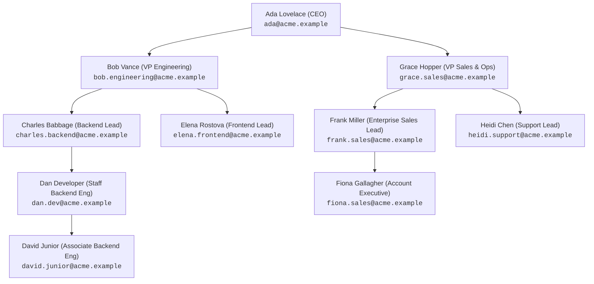
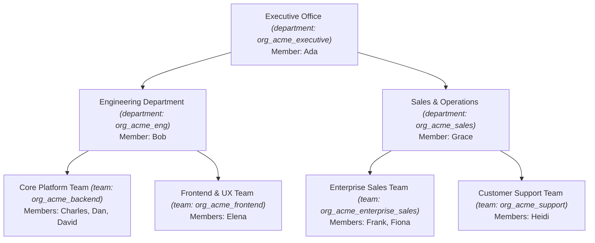

# Test users and account maintenance

Sample accounts for local testing, and how each kind of user is created and managed. The samples are temporary and only work in dev mode.

## Sample accounts

Tenant admins sign in to workbench and open Administration. Platform admins sign in to the platform console. <http://localhost:8081/admin> sends each to the right one. All six accounts use the password `t10-sample-password`.

| Sign-in name | Role | What it tests |
| --- | --- | --- |
| `sample-platform` | Platform admin, in no tenant | Every tenant and all platform actions |
| `sample-acme-admin` | Tenant admin of Sample Acme | Managing Acme only. The all-tenants page is refused |
| `sample-globex-admin` | Tenant admin of Sample Globex | Tenant isolation. Acme's page is refused |
| `sample-member` | Member of Sample Acme | No admin access |
| `sample-multi` | Member of both tenants | Picking a tenant at sign-in. Only a platform admin can reset this account |
| `sample-inactive` | Inactive member of Sample Acme | No admin access, and a tenant token is refused |

The tenants are `ten_sample-acme` (Sample Acme) and `ten_sample-globex` (Sample Globex).

The local stack also seeds `ada@acme.example` with the password `change-me-enterprise-admin`. It's a platform admin and the admin of `ten_acme`, and it isn't one of the samples, so removal leaves it alone.

## Acme Organization Hierarchy and Seed Accounts

The `ten_acme` tenant includes a multi-tier hierarchy across two departments (Engineering, Sales & Operations) to demonstrate organizational structure, reporting lines, and data permission boundaries.

### Org Chart: Reporting Line (Manager Chain)



### Org Chart: Organizational Units (Departments & Teams)



### Account Credentials & Placement Directory

All accounts belong to `ten_acme` and can sign in to Workbench at <http://127.0.0.1:18060> (or `8083`).

| Name | Sign-In Name | Password | Org Unit | Reports To |
| :--- | :--- | :--- | :--- | :--- |
| **Ada Lovelace** | `ada@acme.example` | `change-me-enterprise-admin` | Executive Office | *(CEO / Top-level)* |
| **Bob Vance** | `bob.engineering@acme.example` | `t10-sample-password` | Engineering Dept | Ada Lovelace |
| **Charles Babbage** | `charles.backend@acme.example` | `t10-sample-password` | Core Platform Team | Bob Vance |
| **Dan Developer** | `dan.dev@acme.example` | `t10-sample-password` | Core Platform Team | Charles Babbage |
| **David Junior** | `david.junior@acme.example` | `t10-sample-password` | Core Platform Team | Dan Developer |
| **Elena Rostova** | `elena.frontend@acme.example` | `t10-sample-password` | Frontend & UX Team | Bob Vance |
| **Grace Hopper** | `grace.sales@acme.example` | `t10-sample-password` | Sales & Operations | Ada Lovelace |
| **Frank Miller** | `frank.sales@acme.example` | `t10-sample-password` | Enterprise Sales Team | Grace Hopper |
| **Fiona Gallagher** | `fiona.sales@acme.example` | `t10-sample-password` | Enterprise Sales Team | Frank Miller |
| **Heidi Chen** | `heidi.support@acme.example` | `t10-sample-password` | Customer Support Team | Grace Hopper |

## Data permissions based on the org tree

The organization hierarchy enforces data access across `auth-server` and `t10-collab` through three core rules:

### 1. Work Delegation: Assignment vs. Offer

When a user sends a work item (`POST /v1/work-items/{id}/send`):

- **Downward in the reporting line (Instant Assignment):** When the recipient is anywhere beneath the sender in the org reporting chain (`transitive=true`), the send immediately creates an `assigned` state. Acceptance is bypassed and ownership moves directly.
  - *Example:* Bob assigning to Dan (transitive report) or Charles assigning to Dan (direct report).
- **Upward or peer send (Pending Offer):** When sending work to a manager up the chain, or to a peer in another team/department, the send creates a `pending` offer. The recipient must explicitly accept before ownership transfers; if declined, access is revoked.
  - *Example:* Dan sending to Charles (manager) or Dan sending to Frank (Sales).

### 2. Manager Read Visibility (`view=reports`)

Controlled by tenant setting `manager_visibility` (`none`, `direct_reports`, `all_reports`):

- `none`: Default. Managers cannot view work items owned by their reports.
- `direct_reports`: Managers can read items owned by their direct reports.
- `all_reports`: Managers can read items owned by anyone in their reporting subtree.
  - **Department isolation:** Bob (VP Eng) can view tasks owned by Charles, Elena, Dan, and David, but cannot see any Sales tasks (Frank, Fiona, Heidi). Grace (VP Sales) sees only Sales tasks. Ada (CEO) sees tasks across all departments.
- **Read-only rule:** Manager visibility never allows editing, commenting, or deleting items.

### 3. Org-Unit Linked Lists (Team Sharing Boundary)

Lists can be linked to an `org_unit_id` from `auth.org_units`:

- Setting `org_unit_id` on a list automatically synchronizes all members of that unit into the list membership (`source = 'org'`).
- Only members of the linked unit have access to the list and its unowned tasks.
- Non-members (e.g. Sales members trying to access the Core Platform Backlog) receive `404 Not Found`.

## Agents and the organization

As `sample-acme-admin`, open Sample Acme. **Organization** builds the unit tree, and each member's row on **Members** sets their manager and unit. **Agents** lists every call and agent run, with a Stop button. It fills up when someone joins a room while the local stack lists a voice runtime in `clients.yaml`.

As `sample-platform`, open **Users** to find anyone by sign-in name or full user ID, suspend or reactivate them, and add or remove the platform role. A suspended account shows a badge on its tenant's **Members** tab.

## Add and remove

With the local stack running:

```sh
docker compose exec auth-server authctl samples-add
docker compose exec auth-server authctl samples-remove
```

Removal deletes the sample accounts, both sample tenants, and what they gathered during testing, such as sessions, devices and invitations.

- A real user who joined a sample tenant loses only that membership.
- An account is treated as a sample by a hidden marker, not its name, so `sample-lookalike` would survive.
- Audit rows stay, because the log is append-only.
- Both commands refuse to run outside dev mode, because the password is published.
- `docker compose down -v` also removes them, along with the rest of the local database.

## How each kind of user is maintained

| User | Created by | Managed by |
| --- | --- | --- |
| Platform admin | `authctl bootstrap` for the first one, then any platform admin from **Users** | Their own account page. They must have an authenticator, and platform actions need a sign-in with it in the last 15 minutes. Another platform admin can remove the role, but the last one can't lose it |
| Tenant admin | An admin invitation, promotion by another admin of that tenant, or a platform admin adding them by user ID. Anyone who self-registers also runs their own new tenant, but outside dev mode registration needs an invitation | Other admins of that tenant, or a platform admin. The last active admin can't be removed |
| Member | An invitation link, or `authctl add-user` | Their tenant's admins set role and active or inactive status. A platform admin can suspend the account from **Users**, which applies in every tenant |

**Reset links:** a tenant admin can only reset a plain member who belongs to that tenant alone. Everyone else needs a platform admin.

## Not built yet

- **Deleting real users or tenants:** only the samples can be deleted. Real users and tenants can be suspended.
- **Removing a lost authenticator:** this is still an open decision in the design.

## Property demo users

The local property seed adds `property-steward`, `property-customer-service`,
`property-maintenance`, `property-manager`, and `property-finance` to Sample Acme
(`ten_sample-acme`). Password: `t10-sample-password`. These are ordinary members
with auth business roles and property-owned scope bindings. See
[`t10-property/README.md`](../../t10-property/README.md) for scopes and seed commands.
They are created separately from `samples-add`; reseed property after rebuilding
sample tenants. Property screens are in workbench; the API is at localhost port 18075.
